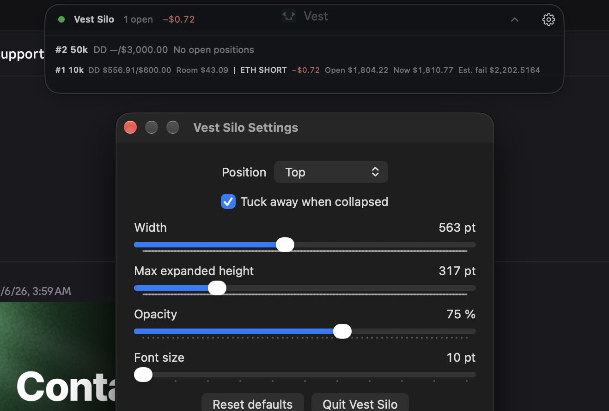
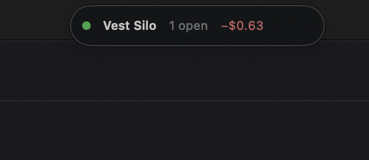

# Vest Silo

Vest Silo is a standalone macOS widget for tracking your Vest Markets positions. The collapsed bar shows your open position count and combined unrealized P&L. Expand it to see entry and current mark prices, estimated fail prices, and account drawdown in one row per account.

## Install on macOS

Vest Silo requires macOS 13 or later and runs on both Apple silicon and Intel Macs.

1. Download **Vest-Silo-macOS.zip** under **Assets** on the [latest release](https://github.com/maxlongartist/vest-silo/releases/latest).
2. Double-click the ZIP to extract it, then drag **Vest Silo.app** into **Applications** and open it.
3. Choose **Vest Silo → Connect to Vest…** in the menu bar and sign in on the Vest page. After connecting, you can close that window and use the widget.

The app is ad-hoc signed and has no Apple notarization. If macOS blocks the first launch and you trust the download, see [Apple’s instructions for opening an app from an unidentified developer](https://support.apple.com/en-us/102445).

Vest Silo uses a separate WebKit session and requires no browser extension. On macOS 14 or newer, the app attempts to restore its saved session on launch. If Vest expires that session, open **Connect to Vest…** again.

## Make it yours

Open the gear in the widget or choose **Vest Silo → Settings…**. Use **Position** to move the island to any corner or center it along any edge. You can also adjust its width, maximum expanded height, opacity, and font size. Enable **Tuck away when collapsed** to keep just the compact status strip on screen. Click the strip to expand it again.

To try the layout with sample positions before signing in, run `open -na "/Applications/Vest Silo.app" --args --demo`.

## Build from source

Install Apple’s Command Line Tools with `xcode-select --install`, then run `./build.sh` from the repo folder and open the resulting **Vest Silo.app**. Use `./build.sh --universal` to build for both Mac architectures.

## Support the project

Optional tips are welcome. Open **Settings → Donate to the dev** to copy a BTC, EVM, SOL, or TRX address.

## Privacy

The widget reads account and position data from Vest. The embedded browser manages sign-in locally on your Mac. This repository contains source code and build assets only. Vest Silo is an unofficial project.
